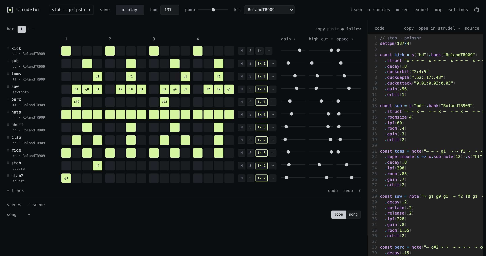

# StrudelUI

A step sequencer and mixer for [Strudel](https://strudel.cc), the live-coding music language.
The grid writes Strudel code, and code you type shows up on the grid: the code is the tune.

**Use it at [strudelui.cc](https://strudelui.cc)**, or [run it yourself](#run-it).

A PXLPSHR project.



## What it does

- **Grid + live code:** 16-step rows per track, the real Strudel editor below them (or beside them, in
  settings); edit either one.
  Tracks written in free code still show their steps, read from the playing pattern.
- **Sounds:** search every sound Strudel knows and hear it before you pick. While playing, each sound you
  browse plays in the tune in place of the track's sound (pick to keep it, Esc to go back).
  Switch drum kits in one go; right-click a sound to trim it on its waveform (`.begin()` / `.end()`).
- **Your samples:** import a sounds folder (each subfolder is a sound, numbered like strudel.cc's
  "import sounds folder"), drop files anywhere, or use "import files…" in the sound picker.
  They stay in the browser.
- **Tracks:** add drum / bass / chord / code / sample tracks, rename, duplicate, reorder, delete.
  Per-track effects: pump, delay, distort, crush, coarse, phaser, low cut, pan, stereo, swing.
- **Mixer:** three slider columns per track (gain, high cut, space by default; click a heading to choose).
  On tablets, car screens and narrow windows they move to a mixer under the scenes.
- **Phones:** the grid, the song (scenes, song, mixer) and the code are views of their own, switched at
  the bottom; the rest of the header is under **⋯**, and a track's **⋯** has its sliders, length and
  effects. Tap a step to set it or drag along a row to paint; a swipe up or down scrolls.
- **Settings:** theme (the default, or strudel.cc's own colours), layout (code below the sequencer, the
  default, or beside it), audio output device (Chrome and Edge), code font size, code helpers
  (autocomplete with docs, docs on ctrl+hover, bracket matching, line wrapping) and editor keys
  (codemirror, vim, emacs, vscode), under **settings** in the header; kept in this browser. **Reset
  everything** there (after a confirm) deletes all StrudelUI data in this browser.
- **Bars and songs:** 1–16 bars per track (shorter ones loop), copy and paste bars (all tracks from the
  bar row, or one track from its **⋯** menu, also between drum and note tracks),
  scenes (`stack(…)`) and a song (`arrange(…)`) that plays them in order, each for any number of bars.
- **Audio out:** export the mix or stems (one WAV per track, zipped) faster than real time, or record live.
- **Files:** save named tunes in the browser; open and download them as `.js`, or as a `.zip` with the
  tune and the imported samples it uses; start a new empty tune. The code's first line is its title (`// name`).
  A tune opened from a link, a file or a zip is code someone else wrote: it doesn't run until you press play
  (or ctrl+enter), so tracks written in plain code show their steps from then on.
- **MIDI files:** open or drop a `.mid` to make it a new tune. Drums (channel 10) become one drum track per
  sound on the kit you have picked, other parts note tracks on Strudel's General MIDI sounds (`gm_…`), and
  a chord part a few tracks, one per voice (up to 4). Notes move to the nearest 16th; velocity, pitch bends
  and tempo changes aren't kept, and the grid holds the first 16 bars. The status line says what changed.
- **Hydra visuals:** `await initHydra()` in the code draws [Hydra](https://strudel.cc/learn/hydra/) behind
  the code panel, not over the app. It stops when the code no longer starts it, or another tune opens.
- **Demos:** file → demos… opens **stab - pxlpshr** (the tune a first visit opens) and the tunes in `demos/`.
  **visuals demo** uses every visual Strudel draws inside the code: `_scope`, `_punchcard`, `_spiral`,
  `_pianoroll`, `_pitchwheel`, `_spectrum` and `markcss`.
- **Learn:** `learn.html` teaches Strudel from zero through the grid, with examples you can play, edit
  and open in the app, and links to Strudel's own docs.

Everything it writes is plain Strudel: copy the code or use "open in strudel" to take a tune to strudel.cc.
Mutes and solo are part of the code too (`// kick,` is muted, `kick, // solo` is soloed).

## Keys

The **?** under the grid lists the main ones in the app.

| | |
|---|---|
| space | play / stop (when a button isn't focused) |
| cmd/ctrl + s | save |
| cmd/ctrl + z, shift + cmd/ctrl + z or cmd/ctrl + y | undo, redo |
| ctrl + enter (in the editor) | apply typed code |
| click or drag on steps | set steps (touch: tap, or drag along the row; a swipe up or down scrolls) |
| right-click a note step, or scroll / ↑↓ on it | pick or nudge the note (long-press on a phone) |
| [ ] | previous / next bar |
| click a bar, then click it again | stay on that bar while it plays, then follow the playhead again |
| cmd/ctrl + c, v (outside the editor) | copy / paste a bar |
| click a sound, ←→ on it | change it, step through its variations |
| right-click a sound | trim it (long-press on a phone) |
| right-click a track name | its effects (on a phone: its **⋯** → effects) |
| drag a name (touch: its ⠿), or ↑↓ on it | reorder tracks |
| double-click a name | rename |
| double-click a slider | remove that setting from the code |
| click a slider column's heading | choose what the column shows (kept in this browser) |
| double-click a scene | rename it (the song follows) |

## Pump and swing

**Pump** is sidechain ducking: the kick's `.duckorbit("2:4:5")` / `.duckdepth(".52:.17:.43")` dip those
orbits on every hit. The header's pump sets how hard; a track's pump switch (in its effects) puts it in or
out at that amount. Ducking, reverb and delay are per orbit, so switching a track that shares its orbit
first moves it to one of its own. For different depths per track, edit `.duckdepth` in the code.

**Swing** (in a track's effects) writes `.swingBy(x, 8)`: every second 16th plays late by `x` of a 16th
(.17 light, .33 triplet). The grid still shows straight steps.

## Controllers

Play it from a MIDI controller or the computer keyboard. Press **map**, then **map controls…**:
click a control, then turn a knob, press a pad or press a key to link them. Esc when done.

- Mappable: play/stop, bpm, pump, each track's mute, solo and three slider columns, bar pages,
  scenes, and the steps of the bar on screen. Map a step, then keep pressing pads: each one takes
  the next step, so a 16-pad grid maps a row in 16 presses.
- Knobs and faders move sliders (one undo step per turn); pads, notes and keys toggle or press.
  Buttons that send CC work too (a press is the value rising past 64).
- Keys: letters, digits, punctuation and the number pad, without modifiers. Space, `[ ]` and the
  shortcuts above stay as they are, and keys do nothing while you type in the editor or a field.
- Mappings are kept in this browser per device and control, and name tracks, so they work in any
  tune with the same track names (renaming a track takes its mappings along). The map panel lists
  them (× removes one) and exports / imports them as JSON.
- MIDI needs Web MIDI: Chrome or Edge (the browser asks once). Safari has none; keys work everywhere.

## Run it

It's static files, no build. Serve the folder (ES modules don't load from `file://`):

```bash
npm start
```

(that's `python3 -m http.server 5173`), then open http://localhost:5173. Made in Chromium browsers and
tested there and in Safari on iPhone; Firefox and desktop Safari should work but aren't regularly tested.

To put it online, any static host works (all paths are relative).

## Where things are kept

Everything stays in your browser, for this site only. **settings → reset everything** (or clearing the site's
data) deletes it.

- the tune you're working on: autosaved in localStorage
- named saves: localStorage (a few MB in all, so download big tunes as `.js`)
- your samples: IndexedDB
- settings and theme: localStorage

Sounds load from Strudel's sample collections online, so it needs a connection.

## Sharing a tune

- **download .js** is the code alone. Built-in sounds work anywhere; your own samples don't travel with it
  (nor with "open in strudel").
- **download with samples (.zip)** adds the samples of yours the tune uses, as `samples/<sound>/…`, the
  layout strudel.cc's "import sounds folder" reads too. Opening or dropping the zip imports them and
  loads the tune.
- A tune that uses samples this browser doesn't have marks those sounds with a red **!** (hover it for
  which file) and lists them when it opens; import them with **+ samples** and the marks go.

## Export notes

- WAVs are 32-bit float, so nothing clips in the file; the export reports the peak level.
- Up to 256 bars, and up to 16 tracks playing at once for stems.
- Stems are rendered with each track on its own effects bus, so a track's reverb or delay is its own.
  In the mix, tracks sharing an orbit share those effects, so stems won't sum to the mix exactly.

## Tests

```bash
npm test        # the code ↔ grid model, MIDI files, mapping files, trim, zips (Node 22+)
npm run smoke   # the app in headless Chrome: playback, edits, exports, demos, MIDI, Hydra,
                #   tablet and phone layouts, learn examples
```

Both run on every push.

## Keeping Strudel up to date

Strudel's engine is vendored from npm (`vendor/strudel-repl/VERSION` says which release), so the app
only changes when it is updated on purpose. To update:

```bash
npm run update-strudel          # newest release (or: npm run update-strudel 1.4.0)
npm test && npm run smoke
```

A weekly GitHub Action opens a pull request when a newer release is out; merge it when its tests pass.

## Files

| | |
|---|---|
| `code.js` | reads tune code into tracks and writes edits back |
| `app.js` | the grid, mixer, scenes/song, file menu |
| `sounds.js`, `picker.js` | sound catalog, preview, your samples |
| `trim.js` | the trim panel: waveform, start / end handles |
| `popover.js` | the floating panels and menus (bottom sheets on phones) |
| `settings.js` | the settings panel: theme, layout, audio output, code font size, helpers, keys |
| `theme.css`, `theme.js` | the strudel theme's colours; applying the saved theme and layout before first paint |
| `controllers.js` | MIDI and keyboard mapping (map mode, mappings file) |
| `export.js`, `render.html`, `render.js` | mix/stem export (rendered in a throwaway frame) and live recording |
| `files.js` | saved tunes, opening `.js` / `.strudel` / `.zip` tune files |
| `midi.js` | reading MIDI files and turning them into a tune |
| `zip.js` | writing and reading zips (stems, tunes with their samples) |
| `default.js` | the tune a first visit opens |
| `demos/` | the tunes in file → demos… (add one to `DEMOS` in `app.js`) |
| `learn.html`, `learn.js` | the learn page: lessons with playable examples |
| `test/` | tests for `code.js`, `controllers.js`, `midi.js`, `trim.js` and `zip.js`; `fixtures/`: tune files they read |
| `scripts/` | the browser smoke test and the Strudel update script |
| `.github/workflows/` | the tests on every push; the weekly Strudel update pull request |
| `docs/` | the screenshot |
| `og.png` | the image link previews show (chat apps, social sites) |
| `vendor/strudel-repl/` | Strudel's editor and audio engine, [@strudel/repl](https://www.npmjs.com/package/@strudel/repl) 1.3.0, unmodified |

## License

StrudelUI is free software: you can redistribute it and/or modify it under the terms of the
[GNU Affero General Public License](LICENSE), version 3 or (at your option) any later version,
as required by Strudel, which it's built on. It comes with no warranty.
If you run a changed version for others, the AGPL asks you to offer them its source.

Strudel is made by the [Strudel contributors](https://codeberg.org/uzu/strudel) (AGPL-3.0-or-later).
Drum machine samples load from the [tidal-drum-machines](https://github.com/ritchse/tidal-drum-machines) collection.
